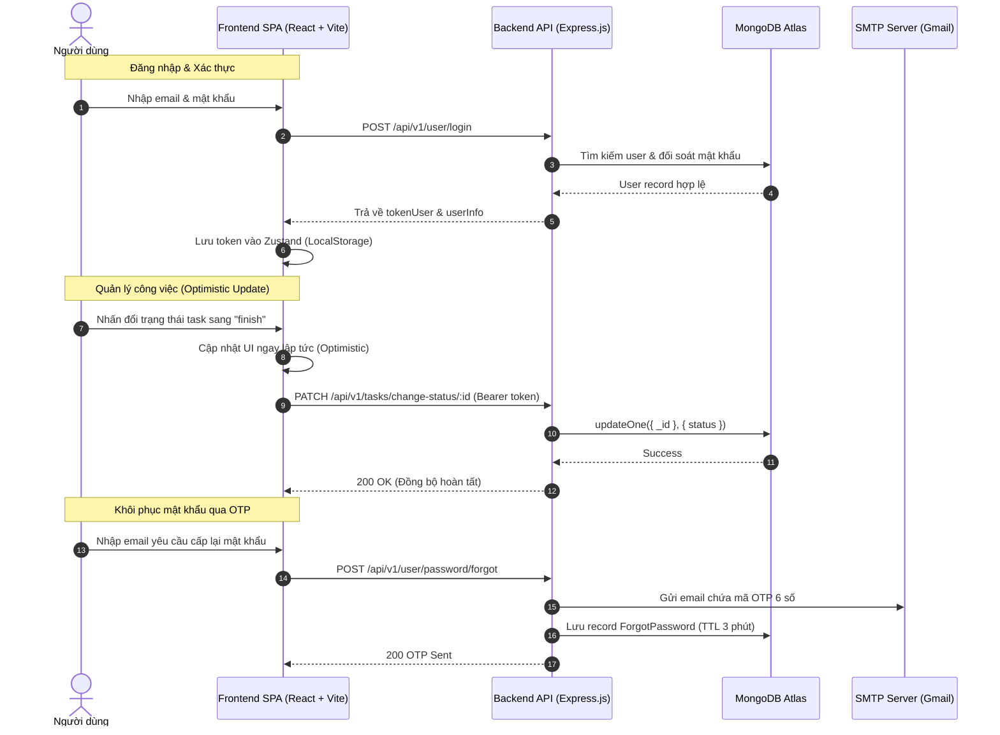
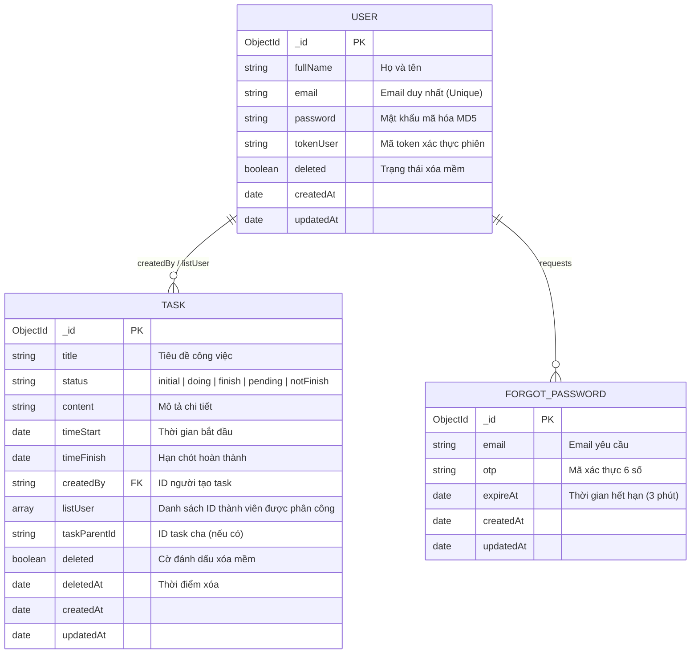

# 🚀 TaskMaster - Modern Full-Stack Task Management Platform

<p align="center">
  
</p>

<p align="center">
  <a href="#-tính-năng-cốt-lõi-key-features"></a>
  <a href="#-công-nghệ-sử-dụng-tech-stack"></a>
  <a href="#-công-nghệ-sử-dụng-tech-stack"></a>
  <a href="#-công-nghệ-sử-dụng-tech-stack"></a>
  <a href="#-công-nghệ-sử-dụng-tech-stack"></a>
  <a href="#-công-nghệ-sử-dụng-tech-stack"></a>
  <a href="#-công-nghệ-sử-dụng-tech-stack"></a>
  <a href="#-công-nghệ-sử-dụng-tech-stack"></a>
</p>

---

## 📖 1. Giới thiệu dự án (Elevator Pitch)

**TaskMaster** là nền tảng quản lý công việc và phân chia dự án toàn diện được xây dựng theo chuẩn **Full-Stack Clean Architecture**. Hệ thống kết hợp giữa **Backend RESTful API hiệu năng cao** (Node.js/Express + MongoDB Atlas) và **Frontend Single-Page Application (SPA) phản hồi tức thì** (React 18 + TypeScript + Vite + Tailwind CSS + TanStack Query v5).

Dự án giải quyết triệt để bài toán theo dõi tiến độ công việc, gán người thực hiện, tìm kiếm tức thì với Debounce, phân trang máy chủ, bảo mật phiên làm việc với Bearer Token và quy trình khôi phục mật khẩu đa bước qua mã xác thực OTP 6 số gửi tới email người dùng.

### 🖼️ Demo Giao Diện (Visual Interface Preview)
```text
+------------------------------------------------------------------------------------------------------+
|  TaskMaster Enterprise                                                   [Trần Đức Lợi] [Đăng xuất]   |
+------------------------------------------------------------------------------------------------------+
|  [ 📊 Tổng số: 12 ]       [ ⏳ Đang làm: 4 ]       [ ✅ Hoàn thành: 6 ]       [ ⚠️ Tạm hoãn/Chưa: 2 ] |
+------------------------------------------------------------------------------------------------------+
|  🔍 Tìm kiếm theo tiêu đề...     | Trạng thái: [Tất cả v] | Sắp xếp: [Mới nhất v] | [+ Thêm Task]     |
+------------------------------------------------------------------------------------------------------+
|  [x] Thiết kế Database Schema               | [ ] Xây dựng RESTful API     | [ ] Viết Unit Test      |
|  Trạng thái: [ Hoàn thành ]                 | Trạng thái: [ Đang làm ]     | Trạng thái: [ Tạm hoãn ]|
|  Thời hạn: 24/10/2026 -> 28/10/2026         | Thời hạn: 25/10 -> 30/10     | Thời hạn: 26/10 -> 02/11|
|  Mô tả: Thiết kế Task, User, OTP model      | Mô tả: Viết Express route    | Mô tả: Test Jest/Vitest |
|  [Status v] [✏️ Sửa] [🗑️ Xóa]             | [Status v] [✏️ Sửa] [🗑️ Xóa]| [Status v] [✏️ Sửa] [🗑️]|
+------------------------------------------------------------------------------------------------------+
|  [Đang chọn 2 công việc] ---> [ Đánh dấu hoàn thành ] [ Xóa các mục đã chọn ]                        |
+------------------------------------------------------------------------------------------------------+
|  Hiển thị 6 / tổng số 12 công việc                                    [< Trước] Trang 1 / 2 [Sau >]  |
+------------------------------------------------------------------------------------------------------+
```

---

## ✨ 2. Tính năng cốt lõi (Key Features)

### 🔐 1. Xác thực & Quản lý Tài khoản (Auth Module)
- **Đăng ký & Đăng nhập:** Mã hóa mật khẩu MD5 an toàn, sinh phiên đăng nhập ngẫu nhiên `tokenUser` 30 ký tự duy nhất.
- **Xác thực API tập trung (`authMiddleware`):** Kiểm tra quyền truy cập thông qua header chuẩn `Authorization: Bearer <tokenUser>`.
- **Khôi phục mật khẩu 3 bước qua OTP:**
  1. Nhập email nhận mã OTP 6 số qua **Nodemailer**.
  2. Xác thực mã OTP có giới hạn thời gian (TTL 3 phút).
  3. Thiết lập mật khẩu mới an toàn.
- **Phiên làm việc bền vững (Session Persistence):** Tự động lưu và phục hồi trạng thái đăng nhập qua Zustand Store.

### 📋 2. Quản lý công việc chuyên sâu (Task Management)
- **Chu trình CRUD toàn diện:** Tạo mới, xem chi tiết, chỉnh sửa thông tin và xóa mềm (`soft delete` với cờ `deleted: true` & `deletedAt`).
- **5 trạng thái vòng đời task:** `initial` (Chưa bắt đầu), `doing` (Đang làm), `finish` (Hoàn thành), `pending` (Tạm hoãn), `notFinish` (Chưa xong).
- **Thao tác hàng loạt (Batch Operations):** Cập nhật trạng thái hoặc xóa nhiều task đã chọn cùng lúc chỉ với 1 request (`change-multi`, `delete-multi`).
- **Phân cấp và phân công:** Hỗ trợ task cha (`taskParentId`) và gán danh sách thành viên thực hiện (`listUser`).

### ⚡ 3. Trải nghiệm người dùng cao cấp (Senior UI/UX Standards)
- **Optimistic Updates:** Giao diện lập tức phản hồi ngay khi người dùng đổi trạng thái hoặc xóa task, tự động hoàn tác (rollback) nếu server báo lỗi.
- **Debounced Search:** Độ trễ tìm kiếm 400ms ngăn chặn spam request lên server database.
- **Toàn diện trạng thái biên (Edge Cases):** Skeleton loader khi đang tải, Empty state sinh động khi danh sách rỗng, Error banner kèm nút Retry thử lại.
- **Form validation chặt chẽ:** Kết hợp **React Hook Form** và **Zod schema** để validate dữ liệu đầu vào.

---

## 🏛️ 3. Sơ đồ kiến trúc & Luồng hoạt động (Architecture & ERD)

### 🔄 Luồng hoạt động hệ thống (System Sequence Flow)


### 🗄️ Sơ đồ cơ sở dữ liệu (Entity Relationship Diagram - ERD)


---

## 🛠️ 4. Công nghệ sử dụng (Tech Stack)

### Frontend Architecture
| Thư viện / Công nghệ | Phiên bản | Mục đích & Vai trò |
| :--- | :--- | :--- |
| **React** | `^18.3.1` | Thư viện xây dựng giao diện người dùng component-based |
| **TypeScript** | `^5.6.3` | Đảm bảo tính an toàn kiểu dữ liệu (Strict Mode, Zero `any`) |
| **Vite** | `^5.4.9` | Build tool và Dev Server tốc độ cao kèm Reverse Proxy |
| **Tailwind CSS** | `^3.4.14` | Framework CSS tiện ích cho giao diện hiện đại, responsive |
| **TanStack React Query** | `^5.59.0` | Quản lý Server State, caching, synchronization & Optimistic Updates |
| **Zustand** | `^5.0.0` | Global state cho phiên đăng nhập (Auth Session) & Toast notification |
| **React Hook Form + Zod** | `^7.53` / `^3.23` | Xử lý form hiệu năng cao, validate dữ liệu đầu vào nghiêm ngặt |
| **Lucide React** | `^0.453.0` | Bộ biểu tượng icon hiện đại, sắc nét |

### Backend Architecture
| Công nghệ | Phiên bản | Mục đích & Vai trò |
| :--- | :--- | :--- |
| **Node.js** | `>= 18.x` | Môi trường runtime JavaScript phía server |
| **Express.js** | `^5.3.0` | Framework web xây dựng hệ thống RESTful API |
| **MongoDB & Mongoose** | `^9.11.4` | Cơ sở dữ liệu NoSQL đám mây và thư viện ODM |
| **Nodemailer** | `^10.2.1` | Dịch vụ gửi email thông báo và mã xác minh OTP |
| **CORS & Body-Parser** | `^2.8` / `^2.4` | Xử lý Cross-Origin Resource Sharing và JSON payload |
| **MD5 & Crypto** | `^2.3.0` | Băm mật khẩu và sinh mã token bảo mật |

---

## 📂 5. Cấu trúc thư mục dự án (Full-Stack Monorepo Structure)

```text
task-management/
├── api/                                     # BACKEND: Core API Logic
│   └── v1/
│       ├── controllers/client/              # Bộ điều khiển (task.controller.js, user.controller.js)
│       ├── middlewares/client/              # Middleware xác thực (user.middleware.js)
│       ├── models/                          # Mongoose Schemas (task, user, forgot-password)
│       └── routes/client/                   # Định tuyến endpoints (/tasks, /user)
├── config/
│   └── database.js                          # Kết nối cơ sở dữ liệu Mongoose
├── helpers/                                 # Helpers tiện ích (generate, pagination, search, sendMail)
├── frontend/                                # FRONTEND: React SPA Client
│   ├── src/
│   │   ├── types/                           # Strict TypeScript Definitions (task, auth, api)
│   │   ├── services/                        # HTTP Client (axiosClient.ts, task.service, auth.service)
│   │   ├── store/                           # Global Stores (useAuthStore, useToastStore)
│   │   ├── hooks/                           # Custom Hooks (useTasks, useAuth, useDebounce)
│   │   ├── components/
│   │   │   ├── common/                      # Button, Input, Modal, Skeleton, EmptyState, Toast
│   │   │   └── layout/                      # Navbar, DashboardStats
│   │   ├── features/
│   │   │   ├── auth/                        # LoginForm, RegisterForm, ForgotPasswordModal, AuthModal
│   │   │   └── tasks/                       # TaskCard, TaskFilterBar, TaskBatchActions, TaskFormModal
│   │   ├── App.tsx                          # App Component gốc
│   │   ├── main.tsx                         # Entry React DOM & QueryClient
│   │   └── index.css                        # Tailwind Directives & Custom Animations
│   ├── index.html                           # Trang HTML chính
│   ├── package.json                         # Dependencies Frontend
│   ├── tailwind.config.js                   # Cấu hình Tailwind CSS
│   ├── tsconfig.json                        # Cấu hình TypeScript Strict Mode
│   └── vite.config.ts                       # Cấu hình Vite & Proxy tới Backend (:3000)
├── .env                                     # Biến môi trường Backend (Private)
├── .env.example                             # Mẫu biến môi trường cho cộng đồng
├── index.js                                 # File khởi chạy máy chủ Express
├── package.json                             # Dependencies Backend
├── vercel.json                              # Cấu hình triển khai Serverless lên Vercel
└── README.md                                # Tài liệu kỹ thuật dự án
```

---

## ⚙️ 6. Cài đặt và Khởi chạy (Getting Started)

### 📋 Yêu cầu tiên quyết
- **Node.js**: Phiên bản `18.x` hoặc `20.x` trở lên ([Tải tại nodejs.org](https://nodejs.org/))
- **MongoDB**: MongoDB Local hoặc cụm kết nối đám mây **MongoDB Atlas**
- **Trình quản lý gói**: `npm` hoặc `yarn`

---

### 🚀 Hướng dẫn chi tiết từng bước

#### Bước 1: Clone kho mã nguồn
```bash
git clone https://github.com/your-username/task-management.git
cd task-management
```

#### Bước 2: Cài đặt Dependencies cho cả 2 phía

```bash
# Cài đặt gói phụ thuộc cho Backend (tại thư mục gốc)
npm install

# Cài đặt gói phụ thuộc cho Frontend
cd frontend
npm install
cd ..
```

#### Bước 3: Cấu hình biến môi trường (`.env`)
Tạo file `.env` tại thư mục gốc `task-management/` dựa trên mẫu:

```env
# Cổng chạy ứng dụng Backend
PORT=3000

# Chuỗi kết nối MongoDB (Local hoặc Atlas)
MONGO_URL=mongodb+srv://<username>:<password>@cluster0.mongodb.net/task-management?retryWrites=true&w=majority

# Tài khoản Gmail dùng để gửi mã xác thực OTP (Mật khẩu ứng dụng - App Password 16 ký tự)
EMAIL_USER=your_email@gmail.com
EMAIL_PASS=your_app_password
```

> 💡 **Mẹo cấu hình Gmail App Password:** Vào tài khoản Google &rarr; *Bảo mật* &rarr; Bật *Xác minh 2 bước* &rarr; Chọn *Mật khẩu ứng dụng* &rarr; Tạo mật khẩu mới và dán vào `EMAIL_PASS`.

---

### 🖥️ Khởi chạy hệ thống (Cần chạy song song 2 Terminal)

Để Frontend và Backend giao tiếp trơn tru, bạn cần mở **2 cửa sổ Terminal** riêng biệt:

#### 🟢 Terminal 1: Khởi động Backend (Express API)
```bash
cd D:\task-management
npm start
```
> Server sẽ khởi chạy tại: `http://localhost:3000`  
> Nhận thông báo: `App listening on port 3000` & `Kết nối databse thành công!`

#### 🔵 Terminal 2: Khởi động Frontend (React + Vite)
```bash
cd D:\task-management\frontend
npm run dev
```
> Ứng dụng Frontend sẵn sàng tại: `http://localhost:5173`  
> Mọi request gọi `/api/v1/...` sẽ được Vite tự động chuyển tiếp tới `http://127.0.0.1:3000`.

---

## 📡 7. Tài liệu API cơ bản (API Endpoints Overview)

Tất cả các API Backend được định tuyến với tiền tố: `/api/v1`

### 🔑 Authentication Endpoints (`/api/v1/user`)
| Method | Endpoint | Yêu cầu Auth | Mô tả chức năng | Request Body mẫu |
| :--- | :--- | :---: | :--- | :--- |
| `POST` | `/user/register` | ❌ | Đăng ký tài khoản người dùng mới | `{"fullName": "Nguyen Van A", "email": "a@gmail.com", "password": "123"}` |
| `POST` | `/user/login` | ❌ | Đăng nhập hệ thống, lấy tokenUser | `{"email": "a@gmail.com", "password": "123"}` |
| `POST` | `/user/password/forgot` | ❌ | Gửi mã OTP 6 số qua email xác thực | `{"email": "a@gmail.com"}` |
| `POST` | `/user/password/otp` | ❌ | Xác minh mã OTP (hiệu lực 3 phút) | `{"email": "a@gmail.com", "otp": "123456"}` |
| `POST` | `/user/password/reset` | ❌ | Đặt lại mật khẩu mới | `{"tokenUser": "token_str", "password": "new_password"}` |
| `GET` | `/user/info` | ✅ | Lấy thông tin cá nhân của phiên đăng nhập | *Header: `Authorization: Bearer <tokenUser>`* |

### 📌 Task Endpoints (`/api/v1/tasks`)
| Method | Endpoint | Yêu cầu Auth | Mô tả chức năng | Request Params / Body mẫu |
| :--- | :--- | :---: | :--- | :--- |
| `GET` | `/tasks` | ✅ | Lấy danh sách task kèm phân trang & lọc | Query: `?status=doing&keyword=api&page=1&limit=6&sortKey=createdAt&sortValue=desc` |
| `GET` | `/tasks/detail/:id` | ❌ | Lấy chi tiết thông tin một task | Param: `:id` của task |
| `POST` | `/tasks/create` | ✅ | Tạo mới một công việc | `{"title": "Làm UI", "content": "Code React", "status": "doing", "timeStart": "2026-10-26", "timeFinish": "2026-10-30"}` |
| `PATCH`| `/tasks/edit/:id` | ✅ | Cập nhật toàn bộ thông tin task | `{"title": "Tiêu đề mới", "status": "finish"}` |
| `PATCH`| `/tasks/change-status/:id` | ❌ | Cập nhật nhanh trạng thái đơn lẻ | `{"status": "finish"}` |
| `PATCH`| `/tasks/change-multi` | ❌ | Cập nhật trạng thái nhiều task cùng lúc | `{"ids": ["id1", "id2"], "key": "status", "value": "finish"}` |
| `PATCH`| `/tasks/delete/:id` | ❌ | Xóa mềm công việc (đưa vào thùng rác) | Đánh dấu `deleted: true`, lưu `deletedAt` |
| `PATCH`| `/tasks/delete-multi` | ❌ | Xóa mềm hàng loạt nhiều công việc | `{"ids": ["id1", "id2"]}` |

---

## 👨‍💻 8. Tác giả & Giấy phép (Author & License)

- **Tác giả:** Trần Đức Lợi (`tranducloi784`)
- **Email:** [tranducloi784@gmail.com](mailto:tranducloi784@gmail.com)
- **GitHub:** [@tranducloi](https://github.com)
- **Giấy phép:** Bản quyền phát hành dưới giấy phép [ISC License](LICENSE).

<p align="center">
  ⭐ Đừng quên nhấn <b>Star</b> trên GitHub nếu dự án mang lại giá trị cho bạn! ⭐
</p>
